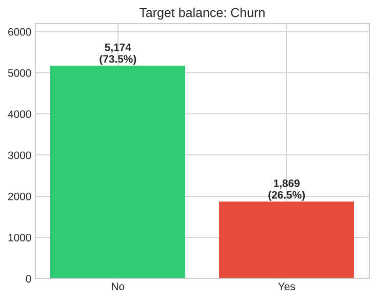
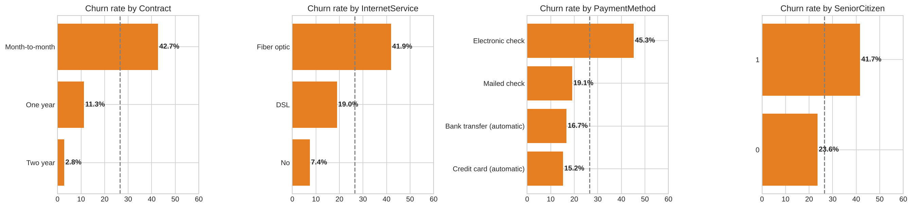
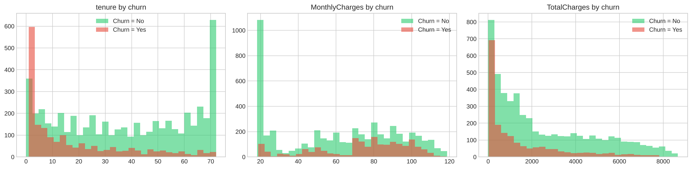
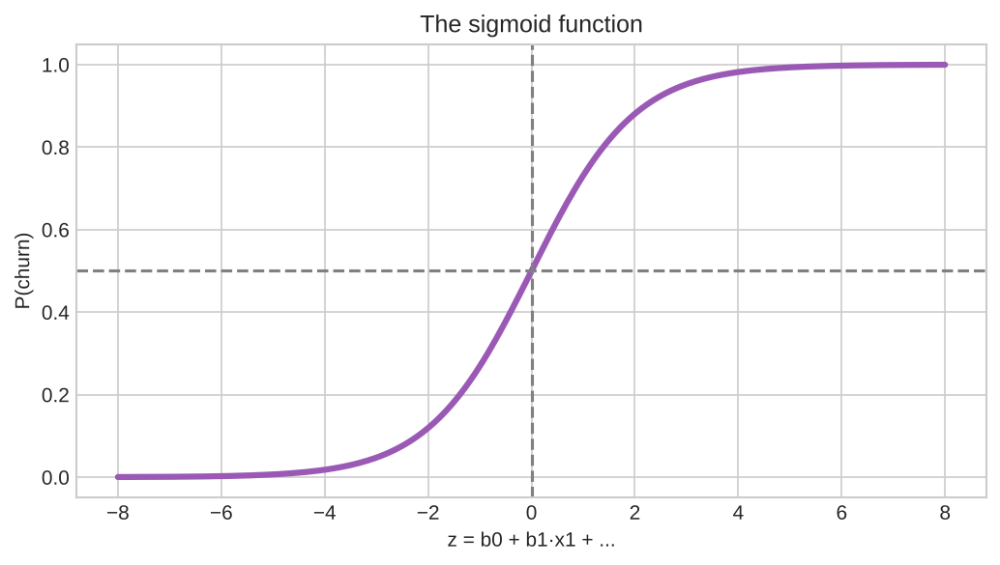
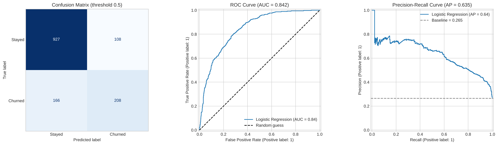
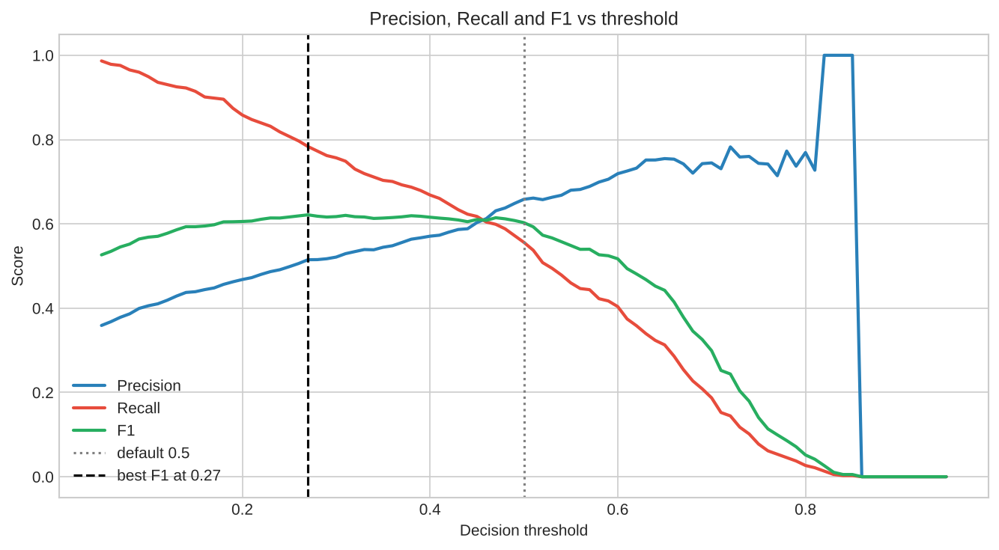
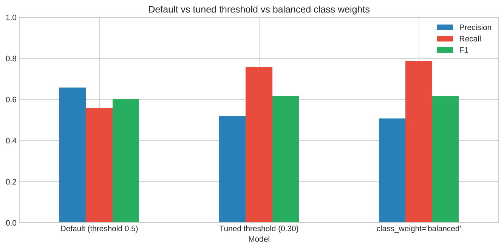
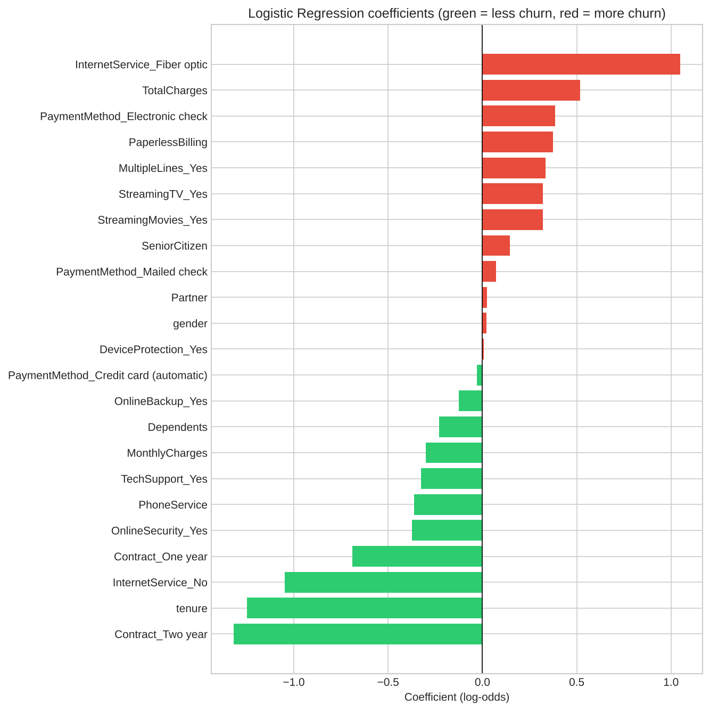
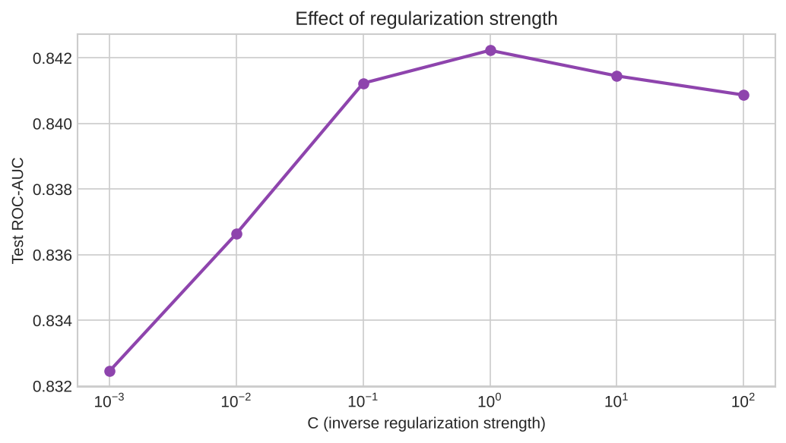

<div align="center">

# 📉 Customer Churn Prediction with Logistic Regression

### Binary classification from raw data to threshold tuning and odds-ratio interpretation


</div>

---

## 🎯 Objective
Implement and understand **logistic regression** by predicting which telecom customers will leave (churn): preprocessing, stratified split, evaluation beyond accuracy, decision-threshold tuning, class weights, odds-ratio interpretation, regularization and cross-validation.

**Dataset:** Telco customer churn, 7,043 customers × 21 columns. Target `Churn`: **26.5%** churned (1,869) vs **73.5%** stayed (5,174).

## ⚡ Highlights

| | |
|---|---|
| 🎯 **Accuracy** | **0.806** (baseline "always No churn" = 0.735), no overfitting (train 0.805) |
| 📈 **ROC-AUC** | **0.842**, 5-fold CV **0.846 (± 0.013)** |
| ⚠️ **Default recall** | Only **0.556**: misses 166 of 374 churners at threshold 0.5 |
| 🎚️ **Tuned threshold (0.30)** | Recall **0.757**, precision 0.521, F1 0.617 |
| ⚖️ **`class_weight='balanced'`** | Recall **0.786**, F1 0.616 (AUC unchanged) |
| 🔍 **Top churn driver** | Fiber optic (odds ×**2.85**); two-year contract cuts odds by **73%** |

## 🔄 Pipeline


## 📂 Project Structure

```
customer-churn-logistic-regression/
├── 📁 data/
│   └── Telco-Customer-Churn.csv     # dataset (7,043 rows, 21 columns)
├── 📁 images/                       # 9 plots generated by the notebook
├── 📓 logistic_regression.ipynb     # full notebook with outputs
├── 📄 requirements.txt
└── 📄 README.md
```

## 🧹 Data Preparation
- `TotalCharges` is stored as text with **11 blank values**, all customers with `tenure = 0` (new customers) → converted to numeric, filled with **0**
- `customerID` dropped; target mapped to 1/0
- Binary columns → 1/0; multi-category columns → **one-hot** (`drop_first=True`)
- "No internet service" / "No phone service" merged into "No", which avoids perfectly duplicated columns
- **StandardScaler** on `tenure`, `MonthlyCharges`, `TotalCharges`, **fitted on the training set only** (no leakage)
- **Stratified** 80/20 split: 5,634 train / 1,409 test, 26.5% churn in both

## 🔎 What Drives Churn?




- **Contract:** month-to-month **42.7%** churn vs one-year 11.3% vs two-year 2.8%
- **Internet:** fiber optic **41.9%** vs DSL 19.0% vs none 7.4%
- **Payment:** electronic check **45.3%** vs 15 to 19% for other methods
- Churners are **newer** (median tenure 10 vs 38 months) and pay **more** (median 79.65 vs 64.43)

## 📈 The Model
Logistic regression passes the linear score through a **sigmoid** so the output is a probability: `P(churn) = 1 / (1 + e^-z)`. It is trained by minimising **log-loss**.



## 🎯 Evaluation (threshold 0.5)

| Metric | Value |
|---|---|
| Accuracy | 0.806 |
| Precision | 0.658 |
| Recall | 0.556 |
| F1 | 0.603 |
| ROC-AUC | 0.842 |
| PR-AUC | 0.635 |
| Log-loss | 0.420 |

Confusion matrix: **TN 927 · FP 108 · FN 166 · TP 208**



> Accuracy alone is misleading on imbalanced data, so the project also reports precision, recall, F1, ROC-AUC and PR-AUC.

## 🎚️ Threshold Tuning


| Threshold | Precision | Recall | F1 | Missed churners |
|---|---|---|---|---|
| 0.50 (default) | 0.658 | 0.556 | 0.603 | 166 |
| 0.40 | 0.571 | 0.668 | 0.616 | 124 |
| 0.35 | 0.545 | 0.703 | 0.614 | 111 |
| 0.30 | 0.521 | 0.757 | 0.617 | 91 |
| **0.27 (best F1)** | 0.515 | 0.783 | **0.621** | 81 |

## ⚖️ Class Weights vs Threshold


| Model | Accuracy | Precision | Recall | F1 | ROC-AUC |
|---|---|---|---|---|---|
| Default (0.5) | 0.806 | 0.658 | 0.556 | 0.603 | 0.842 |
| Tuned threshold (0.30) | 0.751 | 0.521 | 0.757 | 0.617 | 0.842 |
| `class_weight='balanced'` | 0.740 | 0.507 | 0.786 | 0.616 | 0.842 |

The ROC-AUC never changes: moving the threshold or reweighting classes only shifts the **operating point**, it does not make the model "smarter".

## 🔍 Coefficients as Odds Ratios


| Feature | Odds ratio | Meaning |
|---|---|---|
| `InternetService_Fiber optic` | **2.85** | ~2.9x the churn odds of DSL customers |
| `PaymentMethod_Electronic check` | 1.47 | higher churn risk |
| `PaperlessBilling` | 1.45 | higher churn risk |
| `Contract_Two year` | **0.27** | cuts churn odds by ~73% vs month-to-month |
| `tenure` (+1 std) | **0.29** | longer relationships sharply reduce churn |
| `InternetService_No` | 0.35 | no-internet customers rarely churn |
| `OnlineSecurity_Yes` / `TechSupport_Yes` | 0.69 / 0.72 | protection and support reduce churn |

`TotalCharges` (OR 1.68) looks positive only because it is highly correlated with `tenure` (r = 0.83), so it should be read together with `tenure`.

## 🔁 Regularization & Cross-Validation


- Test ROC-AUC peaks at **C = 1** (0.8422, the default) and drops with strong regularization (0.8325 at C = 0.001)
- **5-fold stratified CV ROC-AUC: 0.846 (± 0.013)**, consistent with the test score, so the result is stable

## ▶️ How to Run
```bash
git clone https://github.com/D0027/customer-churn-logistic-regression.git
cd customer-churn-logistic-regression
pip install -r requirements.txt
jupyter notebook logistic_regression.ipynb
```
Also runs on Kaggle: add the Telco churn dataset via **+ Add Input** and click **Run All**.

## 🎤 Interview Questions

<details>
<summary><b>1. Why not use linear regression for classification?</b></summary>

Its output is unbounded (not a probability), it is sensitive to outliers, and thresholding it is unreliable. Logistic regression squashes the score through a sigmoid into (0, 1) and is trained with log-loss.
</details>

<details>
<summary><b>2. What is the sigmoid / logit?</b></summary>

Sigmoid: p = 1 / (1 + e^−z). Its inverse, the logit, is log(p / (1 − p)), the log-odds. Logistic regression models the log-odds as a linear function of the features.
</details>

<details>
<summary><b>3. How do you interpret the coefficients?</b></summary>

A coefficient is the change in log-odds per 1-unit increase in the feature. e^coef is the odds ratio (> 1 raises the event's odds, < 1 lowers them).
</details>

<details>
<summary><b>4. Precision vs recall?</b></summary>

Precision = TP / (TP + FP): how many flagged are real. Recall = TP / (TP + FN): how many real ones were caught. Favour recall when misses are costly (churn, fraud, disease) and precision when false alarms are costly.
</details>

<details>
<summary><b>5. What is ROC-AUC?</b></summary>

The area under the TPR-vs-FPR curve: the probability that a random positive is ranked above a random negative. 0.5 is random, 1.0 is perfect, and it is threshold-independent. On heavily imbalanced data, also check PR-AUC.
</details>

<details>
<summary><b>6. Why is accuracy misleading here?</b></summary>

With 73.5% non-churners, always predicting "stays" scores 73.5%. Use precision, recall, F1 and ROC/PR-AUC.
</details>

<details>
<summary><b>7. How do you choose the decision threshold?</b></summary>

Plot precision, recall and F1 against the threshold and pick the point that matches business costs (a missed churner vs a wasted retention offer), ideally on validation data.
</details>

<details>
<summary><b>8. What is the role of regularization?</b></summary>

The penalty (L2 or L1) shrinks coefficients to reduce overfitting. In scikit-learn, C = 1 / λ, so a smaller C means stronger regularization. L1 can drive coefficients to exactly 0 (feature selection).
</details>

<details>
<summary><b>9. How do you handle imbalanced classes?</b></summary>

Stratified splits, `class_weight='balanced'`, resampling (SMOTE / undersampling), threshold tuning, and metrics such as F1, PR-AUC and recall.
</details>

<details>
<summary><b>10. What are the assumptions of logistic regression?</b></summary>

A binary (or properly encoded) target, independent observations, a linear relationship between features and the **log-odds**, little multicollinearity and enough samples. It does not require normally distributed features or residuals.
</details>

<details>
<summary><b>11. Can it handle more than two classes?</b></summary>

Yes: one-vs-rest, or multinomial (softmax) regression.
</details>

## 👤 Author

**Deepak Yadav**

[](https://github.com/D0027)
[](https://linkedin.com/in/deepakyadav027)
[](https://d0027.github.io)
